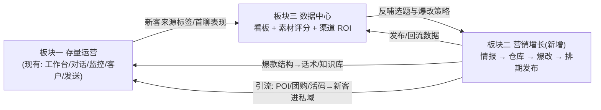

# 私域 AI 工作台 —— 微信私域智能客服 × 餐饮营销增长模块 产品与技术落地方案

> 版本：v1.1（餐饮行业定版 · 待评审进入 Phase 0）
> 产品基线：本仓库 wechat-cs-desktop（微信私域智能客服 v1.0，Electron 39 + electron-vite + React 19 + HeroUI/Tailwind + zustand，主进程分域服务 + IPC + preload + cs.db SQLCipher）。
> 已确认决策：① 目标行业 = **餐饮（本地生活）**；② 接受**第三方数据服务订阅费**；③ 客服与全部业务代码**就在本仓库**，营销模块**直接加入本仓库**（不以独立仓库/插件市场形式）。

---

## 目录

1. [背景与产品定位](#1-背景与产品定位)
2. [顶层蓝图：三块一闭环](#2-顶层蓝图三块一闭环)
3. [餐饮行业定制打法](#3-餐饮行业定制打法)
4. [营销模块产品设计](#4-营销模块产品设计)
5. [信息架构与界面体验](#5-信息架构与界面体验)
6. [技术落地方案（本仓库代码级）](#6-技术落地方案本仓库代码级)
7. [合规与风控专题（餐饮版）](#7-合规与风控专题餐饮版)
8. [落地路线图（里程碑）](#8-落地路线图里程碑)
9. [指标体系](#9-指标体系)
10. [关键决策记录（ADR 摘要）](#10-关键决策记录adr-摘要)
11. [决策清单：已定与待定](#11-决策清单已定与待定)
12. [附录](#12-附录)

---

## 1. 背景与产品定位

### 1.1 现状（本仓库能力盘点）

wechat-cs-desktop 已具备「私域运营客服」主线能力：

| 域 | 已有能力（本仓库现有模块） | 状态 |
|---|---|---|
| 微信读库 | 微信 4.x SQLCipher 解密、会话/消息/联系人读取、变更监控、媒体 .dat 解密 + wxgf 转码、ct-media 协议 | 已落地 |
| 客服 AI | 智能体人设（ai_agent）、OpenAI 兼容 LLM 建议（services/ai/suggest、provider）、AI 助手会话（chat_session/chat_message） | 已落地 |
| 发送 | 注入发送队列（sendService + 频控 + 闭环校验 + 熔断 + send_log 审计） | 已落地 |
| AI 工作台 | 智能体引擎（services/ai/workbench：skills/tools/审批/WS 工具/备忘录） | 已落地 |
| 运营 | 群问题反馈（issue_feedback + 指派/严重度/自动闭环）、客户页派生、监控（opsStats）、数据导出（exceljs）、IM 渠道（飞书/文件接收）、团队报表（PG 上报 chat_sync/report_job 调度）、看板（ECharts） | 已落地 |
| 沉淀 | cs.db：customer/session/tier_rule/knowledge_item/reply_decision 等业务表 | 部分预留 |

### 1.2 缺口与机会

- **拓客手段弱**：现有产品把「存量客户」服务得很好，但没有「把平台公域流量变成私域新客」的内容生产-发布-回流链路；
- 餐饮行业的流量机会集中在**抖音本地生活（同城 + POI + 团购）与小红书种草**，爆款图文/视频可学习可复刻；
- 现成的 AI 管线（provider/工作台引擎/调度/通知/导出）可整体复用，营销模块边际开发成本可控。

### 1.3 目标定位（一句话）

> 把产品从「私域客服工具」升级为**餐饮商家私域 AI 工作台**：智能客服管好存量客户，**爆款情报 + 一键爆改 + 发布回流**持续把公域流量变成私域新客，所有环节共用同一套 AI、数据与审计底座。

### 1.4 设计原则

1. **不动客服主线**：营销模块新增独立的 main/services/growth 服务域 + 独立导航页，仅在既有机制上「加挂」（复用 cs.db/配置/密钥/调度/通知），不改动读库/发送/工作台核心路径；
2. **本地优先**：素材仓库落本机缓存分区 growth/，数据资产属于商家自己；
3. **合规优先、启发式二创**：采集走「第三方数据服务 + 官方后台 + 低频自采」三源；爆改产出「结构启发、文案重写、画面重做」，源素材永不出库；
4. **可解释、可干预**：拆解卡/改写稿逐字段标注，流水线任一步可人工接管；
5. **门店维度**：餐饮商家常为多门店运营，内容、发布、承接、回流按 品牌 → 门店 → 账号/POI 建模。

---

## 2. 顶层蓝图：三块一闭环

| 板块 | 内容 | 对应现有/新增 |
|---|---|---|
| 一 · 存量运营 | 客服会话、AI 工作台、群问题、客户、发送 | 现有能力，保持不动 |
| 二 · 营销增长（新增） | 爆款情报 → 素材仓库 → 一键爆改 → 发布排期 → 承接配置 | 新增 growth 服务域 + 「增长」导航页 |
| 三 · 数据中心 | 看板/ECharts 已有；新增 内容-渠道-承接 ROI 链路 | 部分新增 |



### 2.1 导航演进（渲染层 App.tsx NAV_ITEMS）

当前主侧栏：工作台 · 监控 · 看板 · 对话 · 客户 · 数据（+ 设置）。演进方案：

```
工作台 | 监控 | 看板 | 对话 | 客户 | 增长(新) | 数据 | ...设置
                        └ 增长子导航: 爆款情报 / 素材仓库 / 爆改工坊 / 发布排期 / 承接配置
```

---

## 3. 餐饮行业定制打法

### 3.1 平台格局与机会（餐饮 = 本地生活）

| 平台 | 角色 | 餐饮侧关键机制 |
|---|---|---|
| 抖音 | 同城流量主战场 | POI 门店锚点、团购券（本地生活类目）、探店挂载、同城页、直播 |
| 小红书 | 决策种草场 | 收藏即到店意向、探店笔记、图文比视频的本地认知成本更低 |
| 视频号/公众号 | 私域内容层 | 企微群/朋友圈素材、老客召回 |
| 大众点评/美团 | 承接与评价层 | 门店星级与榜单是本地生活信任状（评价管理属客服职责，与营销联动） |
| 微信私域（本产品主场） | 沉淀转化层 | 企微/客服会话承接：核销提醒、预约、会员群 |

**餐饮内容的本质转化路径**：公域内容（好看/好吃/划算）→ 到店动作（收藏 POI/团购/私信）→ 私域沉淀（进群/加客服）→ 复购与裂变。

### 3.2 餐饮爆款内容类型清单（情报拆解与爆改的对象）

| 爆款类型 | 常见爆款公式 | 采集关键词 | 适合业态 |
|---|---|---|---|
| 出餐/制作过程 | 大火颠勺、现做现出、声音 ASMR、干净后厨 | 出餐、制作、后厨 | 明档/现做类（火锅、烧烤、烘焙、粉面） |
| 价格冲击 | 人均 9.9、套餐拆解、量贩对比 | 人均、团购、套餐、9.9 | 快餐、小吃、咖啡茶饮 |
| 排队人气 | 排队长龙、翻台、等位实况 | 排队、爆满、翻台 | 正餐、网红店 |
| 老板人设 | 老板出镜讲菜品理念/创业故事 | 老板、创业、菜品故事 | 独立品牌 |
| 仪式感/新品 | 新品首发、隐藏吃法、出餐仪式 | 新品、隐藏菜单、吃法 | 茶饮、甜品、火锅 |
| 踩雷/测评 | 避雷、对比、真实测评（需真实体验支撑） | 测评、避雷、红黑榜 | 通用（真实顾客视角） |
| 场景/环境 | 氛围感店面、夜景、包间宴请 | 环境、包间、聚会、宴请 | 正餐、宴请型 |

### 3.3 采集对象的餐饮定制

- **竞品门店账号**：同城同类目 TOP 门店（抖音 POI 关联账号、小红书商家号），入库近 90 天高互动内容；
- **同城探店达人/美食博主**：按 城市 × 类目 圈选达人（第三方数据服务提供达人库与种草/带货数据）；
- **关键词/话题订阅**：类目词（火锅/日料/轻食/咖啡…）+ 场景词（聚餐/下午茶/带娃吃饭）+ 节令词（年夜饭/圣诞/端午）；
- **平台榜单**：抖音同城吃喝玩乐榜、小红书城市美食榜（第三方服务归一化入库）；
- **自营账号数据**：自家门店企业号后台数据（发布与回流用）。

### 3.4 品牌化爆改输入（餐饮专属：品牌资料包）

| 输入 | 内容 | 存放 |
|---|---|---|
| 门店档案 | 门店名/地址/营业时间/包间/停车/招牌菜（每门店一条） | cs.db 新表 growth_store |
| 菜品/套餐库 | 在售菜品与套餐实拍图、价格、卖点、适配人群 | growth 资产 + 标签 |
| 品牌调性 | 定位/人设/语气/视觉风格/禁用语 | growth_brand_profile |
| 资质证照 | 营业执照、食品经营许可证（广告合规校验用，仅本地登记） | growth_license |
| 促销日历 | 上新日、店庆、节令活动 | 排期模块 |

### 3.5 承接链路（增长 × 客服协同，餐饮专属）

`爆款内容(挂 POI + 团购) → 用户收藏/私信/下单 → 平台私信引导(加企微/进群领福利) → 客服承接: AI 首聊(核销/预约/推荐菜) → 打标「来源=内容」→ 到店核销 → 会员群 → 复购裂变`

产品内五个协同触点（落地为既有能力扩展）：
1. **承接配置**：每条发布任务绑定门店（POI/团购链接/企微活码/欢迎语/打标规则）；
2. **新客来源标签**：客服会话对新增联系人按内容来源打标（customer.tags）；
3. **话术联动**：爆款拆解的钩子/卖点一键转客服开场白与活动话术（知识库/技能）；
4. **素材速发**：客服会话直接发送爆改成品图文（复用现有媒体与发送链路）；
5. **需求反哺**：高互动评论主题（有无儿童餐/能否停车/辣度可选等）汇总为门店改进清单与选题来源。

---

## 4. 营销模块产品设计

### 4.1 爆款情报中心（采集）

**用户故事**
- 运营按 城市×业态×竞品门店×达人×关键词/话题 订阅采集源，定时抓近期爆款图文/视频；
- 每条素材带完整互动数据 + AI 拆解卡（钩子/结构/画面/评论高频词）；
- 管理者看「本周赛道趋势」：内容形式变化、卖点词频、同城竞品动作。

**采集三源（S/A/B 分级，详见 6.3）**

| 级别 | 来源 | 作用 | 频率/方式 |
|---|---|---|---|
| S | 第三方数据服务（新红/蝉妈妈等订阅付费，已确认接受） | 榜单/达人/素材互动/趋势 主力数据 | 定时 API 任务 |
| A | 平台官方后台：抖音企业号（本地生活）、小红书专业号 | 自家门店内容与效果数据（回流），合规白名单 | 官方授权 |
| B | 低配补充：粘贴分享链接/口令入库 + 人工补字段 | 覆盖第三方覆盖不到的素材，MVP 即可用 | 手动/低频 |

**入库字段与去重**：平台 ID + 内容 hash 双键去重；互动快照 + 内容文件仅内部参考副本（usage 标记）。

**爆款判定打分（权重可调）**：爆款分 = w1·互动强度 + w2·近7天增速 + w3·结构完整度(钩子/信息封面/CTA) + w4·与品牌(业态×城市×菜系)语义相关度 + w5·新鲜度 − w6·我方重复惩罚

### 4.2 素材仓库（本地爆款仓库）

- 实体：growth_content（源素材或自产素材）+ growth_asset（媒体，hash 物理去重）+ growth_decomp（拆解卡）+ 标签表；
- 双视图：瀑布流/表格；筛选（平台/业态/时间/互动区间/是否已用）+ 全文/语义检索；
- AI 打标与低质清洗；收藏夹与「竞品门店看板」（同城竞品聚合对比）；
- 状态机：入库(新) → 拆解完成(可爆改) → 已爆改 → 已发布 → 回流得分 → 归档/淘汰；
- 来源与授权强制标注（未授权素材在爆改/导出时给出风险提示）。

### 4.3 一键爆改工作台（核心卖点）

**流程**：选素材 → ① 智能拆解 → ② 品牌化改写 → ③ 视觉二创 → ④ 组合成稿 → ⑤ 质检（原创度/违禁词/AIGC 标识）→ ⑥ A/B 多版本。

| 步骤 | 餐饮场景说明 |
|---|---|
| ① 拆解 | 结构卡：钩子开头/前 3 秒画面/卖点次序/情绪节奏/评论高频词；画面要素（出餐镜头/光线/字幕样式） |
| ② 改写 | 标题 5 版 + 文案 2–3 版；输入 = 品牌资料包（门店/菜品库）+ 拆解卡；输出字段级标注改动点 |
| ③ 视觉二创 | 封面模板化（品牌模板 + 自家实拍/菜品图替换）；图生图/文生图可选且强制标「生成示意图」；餐品展示优先自家实拍（AIGC 美食图有合规与信任问题，见第 7 章） |
| ④ 成稿 | 标题+文案+图组/视频+话题（含同城话题与 POI 挂载提示）+ 发布时段建议 → 发布包 |
| ⑤ 质检 | 文本原创度；极限词（最/第一等）+ 餐饮违禁（功效/虚假宣称）；画面相似度；AIGC 标识 |
| ⑥ 多版本 | 一次出 A/B 版（钩子/封面不同）供对比发布 |

**爆改 UI**：素材卡 → 一键爆改向导（步骤条，左参考右编辑，节点可重新生成/手动接管），异步任务出稿进任务中心。

### 4.4 发布排期与承接

| 渠道 | MVP | 后续 |
|---|---|---|
| 抖音企业号 | 导出图文/视频+文案人工发布（挂 POI/团购）；后台数据回填 | 开放能力增强后走 API/草稿箱 |
| 小红书专业号 | 导出 + 半自动发布助手 | 企业专业号 API |
| 视频号/企微群 | 复用现有发送/文件链路排期发送 | 群发 SOP 联动 |
| 承接 | qrcode 生成活码/企微二维码 + 欢迎语 + 打标规则，每门店一套 | 自动绑定发布任务 |

内容日历：月历拖拽 + 渠道×时段建议（回流数据学习）；发布状态机：待发布 → 已发布 → 回填中 → 完成。

### 4.5 效果回流与选题优化

- 回流源：自家企业号后台（人工导出 CSV 兜底 → 官方 API 后续）、客服侧转化事件（新客打标=内容来源）；
- 素材得分 = 转化贡献（新客/核销/成交按来源标签归因）+ 互动贡献，写回素材参与排序；
- 选题雷达：高分素材共同要素 + 热词趋势 → 下周值得爆改的选题；
- 渠道 ROI：内容制作/投放成本 ÷ 来源新增客户（数据中心展示）。
---

## 5. 信息架构与界面体验

### 5.1 导航与页面结构（渲染层）

在 App.tsx 的 NAV_ITEMS 中新增「增长」入口（feather 风格线性图标，与现有图标体系一致），新增 WorkbenchPage 值 growth；增长页内部用次级 Tab（HeroUI Tabs）：

```
工作台 | 监控 | 看板 | 对话 | 客户 | 增长(新) | 数据       设置
                         增长页内子导航:
                         [爆款情报] [素材仓库] [爆改工坊] [发布排期] [承接配置]
```

### 5.2 页面布局（增长页内部）

```
┌────────────────────────────────────────────────────────────┐
│ 增长子导航 Tabs                                              │
├──────────────┬─────────────────────────────────────────────┤
│ 素材瀑布流/列表 │ 详情右侧抽屉: 互动数据 / AI 拆解卡 / 评论高频词   │
│ (虚拟滚动)     │ 操作: 收藏 / 一键爆改 / 标记已用 / 导出          │
├──────────────┴─────────────────────────────────────────────┤
│ 任务中心条: 采集任务 / 爆改任务 / 发布任务 状态 + 完成通知         │
└────────────────────────────────────────────────────────────┘
```

- 爆改工坊 = 向导步骤流（左素材参考、右编辑、底部版本对比 + 质检报告）；
- 发布排期 = 月历（HeroUI Calendar/自绘）+ 任务列表 + 承接配置编辑器；
- 爆款情报 = 榜单/趋势（复用 EChart 组件）+ 采集源管理；
- 素材发送：会话页素材面板调用 growth 查询 → 复用现有发送链路（只发本门店已授权内容）。

### 5.3 体验与状态约定（对齐本仓库既有约定）
1. 复用 HeroUI + Tailwind + shell.css 设计令牌，不引入第二套组件体系；
2. 所有页面「无 mock 数据」：未配置数据源时展示引导与空态（与客服端一致的产品约定）；
3. 任务进度通过 webContents.send 推送（如 cs:growth:progress），顶栏角标 + Electron Notification（复用 notify 节流模式）；
4. 支持深浅色与键盘可达性（对齐近期提交的无障碍要求）；
5. 图片走本地协议（ct-growth:// 或复用 ct-media 注册方式）保证 dev/prod 一致。

---

## 6. 技术落地方案（本仓库代码级）

### 6.1 总体架构（本仓库进程模型内新增 growth 域）

```
┌─ 主进程 (src/main) ───────────────────────────────────────────┐
│ services/growth/            营销增长服务域(新增, 全部新增文件)   │
│   collector/  采集: 第三方数据适配器 + 官方后台 + 链接解析入库     │
│   warehouse/  素材仓库: 增删查/检索/打分/打标/拆解任务入口        │
│   remix/      爆改流水线: 状态机 拆解→改写→二创→质检→成稿         │
│   publisher/  排期日历 + 发布任务 + 承接配置                     │
│   metrics/    回流抓取 + 素材评分 + ROI 聚合                     │
│   media/      图片处理/缩略图/视频抽帧 (ffmpeg 复用既有配置)       │
│   provider/   文本LLM(复用 ai/provider) + 图像生成适配器(可插拔)  │
│   scheduler.ts 心跳调度(仿 report/scheduler 15s 心跳+不重叠)      │
├───────────────────────────────────────────────────────────────┤
│ 复用: cs.db(better-sqlite3) · app_config+secrets · 通知 ·      │
│       导入导出 · ECharts 数据 · PG 上报(可选 growth 报表)        │
└──────────────▲─────────── ipc: cs:growth:* ────┐               │
┌──────────────┴───────────────┐   ┌─────────────▼─────────────┐ │
│ preload: api.cs.growth.*     │   │ renderer: 增长页 + 会话素材面板│ │
│ (index.ts + index.d.ts 类型)  │   │ stores/growth.ts(zustand)  │ │
└──────────────────────────────┘   └───────────────────────────┘ │
```

**新增/修改文件清单（实施时逐项核对）**

| 文件 | 操作 | 内容 |
|---|---|---|
| src/shared/growth.ts | 新增 | growth 域共享类型（IPC 契约 + 领域类型），由 preload/types 引用 |
| src/main/db/schema.ts | 修改 | 追加 growth_* 建表与增量列迁移（见 6.2）；SCHEMA_VERSION 提升 |
| src/main/db/repos/growthRepo.ts | 新增 | 素材/资产/标签/拆解 读写 + 检索查询 |
| src/main/db/repos/growthOpsRepo.ts | 新增 | 采集源/任务/爆改任务/发布任务/回流快照 读写 |
| src/main/services/growth/* | 新增 | 上表所述服务域（按 6.3–6.6 拆分） |
| src/main/ipc/growthHandlers.ts | 新增 | registerGrowthHandlers(): cs:growth:* 全部通道 |
| src/main/index.ts | 修改 | ready 时 registerGrowthHandlers + startGrowthScheduler；before-quit 时 stop |
| src/preload/index.ts | 修改 | api.cs.growth = { ... } 命名空间 |
| src/preload/index.d.ts | 修改 | 引入 shared/growth 类型并补全局声明 |
| src/main/services/paths.ts | 修改 | CACHE_SUB_DIRS 增加 growth；新增 getGrowthAssetsDir/getGrowthExportDir |
| src/renderer/src/stores/growth.ts | 新增 | 增长页 zustand store（数据来自 cs:growth:*） |
| src/renderer/src/pages/GrowthPage.tsx | 新增 | 增长页容器 + 子视图（情报/仓库/爆改/排期/承接） |
| src/renderer/src/App.tsx | 修改 | NAV_ITEMS 增 growth + 图标 + VALID_PAGES |
| src/renderer/src/stores/workbench.ts | 修改 | WorkbenchPage 类型增 growth |
| src/renderer/src/pages/shell.css | 修改 | 增长页样式（沿用设计令牌） |
| src/main/services/ai/provider.ts | 不改 | 爆改文本复用其通道与配置 ai.* |
| 设置页 SettingsPage | 修改 | 增长设置 Section：采集源/数据服务 Key/生成服务 Key/门店档案 |

### 6.2 数据模型（cs.db 追加 growth_* 表）

建表沿用 schema.ts 的 CREATE TABLE IF NOT EXISTS + ensureColumn 增量列风格，全部为追加（不影响既有表与数据）。

```
growth_store          门店档案: 品牌→门店(id/名称/城市/地址/业态/POI列表/营业信息/承接配置JSON)
growth_brand_profile  品牌资料包: 定位/人设/语气/视觉风格/禁用语/资质登记
growth_content        内容主表: 来源平台/类型/标题文案/互动快照/标签/usage/爆款分/状态/dedupe
growth_asset          媒体资产: 内容关联/hash/文件相对路径/类型/宽高时长/来源与授权标记
growth_decomp         AI 拆解卡: 结构/视觉/评论主题 JSON + 模型版本
growth_tag            内容标签(自动/人工 + 置信度)
growth_subscription   采集订阅: 源类型/城市/业态/关键词/账号/频率/启停
growth_crawl_task     采集任务: 每次执行快照(状态/计数/错误)
growth_remix_job      爆改任务: 源素材/门店/模式/流水线快照/状态/进度
growth_remix_output   爆改成品(多版本): 文案/资产/质检结果/原创度/AIGC标识/得分
growth_publish_task   发布任务: 渠道/门店/排期/承接配置/状态
growth_publish_result 发布回执: remote_id/url/时间/错误
growth_metric_snapshot 回流快照: 目标(内容/账号)/渠道/互动/新客/核销/金额/时间
growth_setting        growth 域 KV(与 app_config 并列的域配置,敏感值走 secrets)
```

核心实体关系：growth_store 1—N growth_content（内容可绑定门店）；growth_content 1—N growth_asset / growth_decomp / growth_remix_job；remix_job 1—N remix_output 1—N publish_task 1—N metric_snapshot。

**资产文件**：追加缓存分区 growth/（<cache>/growth/content/<hash前2>/<hash>），DB 只存相对路径；导出包在 <cache>/growth/export 生成后由用户另存。

### 6.3 采集引擎（S/A/B 三源）

**S 级 · 第三方数据服务适配器（growth/collector/thirdparty）**
- 统一适配器接口：fetchHotRank(城市/业态/周期)、searchContent(关键词/话题/账号)、getContentDetail(id)、getAuthorProfile(id)、getTrend(词/周期)；
- 供应商实现为一个配置 + 一个 client 文件（如 providers/xhs-newhong.ts / douyin-chanmama.ts），输出归一化为 growth_content 所需字段；
- 调度：growth/scheduler.ts 心跳扫描到点订阅（interval/daily），单任务不重叠（复用 report scheduler 的 running Map + AbortController 模式）；
- 失败重试 3 次 + 连续失败告警（Notification）；
- 费率与配额在设置页展示（成本透明）。

**A 级 · 官方后台回流（growth/metrics）**：自家抖音企业号/小红书专业号数据，MVP 支持 CSV 导入回填（商家后台导出），官方 API 开放后替换（同一回填函数）。

**B 级 · 链接解析入库（MVP 必备，代码简单无平台风险）**：用户在增长页粘贴小红书/抖音分享链接或口令 → 主进程请求第三方服务详情 API 或平台公开 oEmbed 接口补全标题/封面/互动（以数据服务商详情 API 优先，杜绝无授权抓取）→ 无媒体文件的以「占位 + 备注」入库，标注待补全。

**归一化管道**：适配器原始数据 → zod 校验 → 去重(dedupe_key) → 清洗过滤 → 资产落盘（内部参考副本 usage=ref）→ 入队 AI 打标/拆解 → 打分 → 入库（webContents 广播增量）。

**红线（代码级硬约束，不做可配置逃生口）**：不做验证码对抗、不做 IP 池/代理池、不做未授权批量抓取、单次任务限流；任何第三方服务对单账号数据的抓取均须在服务条款范围内（详见第 7 章）。
### 6.4 一键爆改流水线（growth/remix）

**状态机（异步、可中断、可重试、全步骤落库）**

```
job(queued) → decompose(拆解) → rewrite(改写) → rebuild(视觉二创)
    → compose(成稿) → compliance(质检) → outputs_ready / failed(stage+可重试)
```

- **文本**：改写/拆解/质检复用 services/ai 的 OpenAI 兼容 provider 通道（ai.baseUrl/apiKey/model），结构化输出用 zod 校验后落 growth_decomp / remix_output（与 chat 域一致的可靠性要求：失败不产出，宁可报错不给假货）；
- **多模态拆解与相似度**：需要视觉模型的环节独立配置 growth.visionModel（默认同一 provider 的视觉模型或留空跳过画面拆解，只做文本拆解）；
- **视觉二创适配层（growth/provider/mediaGen.ts）**：统一 imageGen/upscale/thumbnail 接口，接入即梦/可灵/通义万相等 HTTP API；Key 走既有 secrets 机制（safeStorage enc1），设置页维护；生成的图片统一加 AIGC 显式标识并写入元数据；
- **封面模板引擎**：品牌封面模板（SVG/HTML 拼版 + 截图或 canvas 直出）由自家实拍图驱动，不上传第三方（隐私与合规考虑）；
- **质检规则集**：违禁词库（广告法 + 食品餐饮专项 + 品牌自定义）→ 命中阻断并定位；文本原创度报告；与源素材画面相似提示；AIGC 标识检查（强制注入后放行）；资质类断言提醒（食品功效宣称等强制阻断，见 7.3）；
- **成本与预算**：每次任务记录 token 与生成调用量；设置页可设月度预算上限，超限任务自动暂停并通知。

### 6.5 发布排期与回流（growth/publisher + metrics）

- 发布任务表驱动 + 心跳扫描到点发布（与采集同一 scheduler 内核）；
- MVP 发布 = 导出发布包（图文组+文案+话题清单+合规清单 zip / 剪贴板）+ 引导打开官方后台；半自动助手（可选）：主进程打开商家后台登录窗口辅助填表，人工点击发布（不触碰验证类环节）；
- 承接配置：qrcode 生成企微活码图 + 绑定门店 + 欢迎语模板；打标规则写 customer 逻辑（来源渠道字段）；
- 回流：商家后台 CSV 导入（v1）+ 官方 API（后续）→ metric_snapshot → 素材得分写回 → 看板（ECharts）展示漏斗：曝光→互动→收藏/POI→私信/下单→加企微→首聊→核销。

### 6.6 安全、备份与运行约束

| 项 | 方案 |
|---|---|
| 敏感信息 | 数据服务商/生成服务 Key 走 secrets（safeStorage enc1），明文只存主进程内存 |
| 资产隔离 | 素材文件只存本机 growth/ 分区；源素材内不可对外直接发布（usage=ref 强制过原创化质检） |
| 协议安全 | 自定义 ct-growth 协议仿照 ct-media 强校验（文件名/路径白名单），不放开任意文件读取 |
| 数据库 | 全部为追加表/列，不迁移不删除既有数据；user_version 提升；设置页可查看 growth 表空间占用 |
| 退出清理 | before-quit 增加 stopGrowthScheduler()（中止在跑任务）；采集/生成中断均有任务状态兜底 |
| 单机为主 | 数据只在本机；团队报表沿用现有 PG 上报通道（可选扩展 growth 汇总表，不影响 chat_sync） |

---

## 7. 合规与风控专题（餐饮版）

### 7.1 采集与数据（同 v1.0 红线，代码级硬约束）

| 风险 | 依据 | 应对 |
|---|---|---|
| 平台封号/法律风险（绕过风控批量抓取） | 平台服务条款、《数据安全法》第 32 条、不正当竞争抓取判例 | 只走 S/A/B 三源；不做验证码对抗/IP 池/账号池；单任务限流硬编码；异常即停表 + 通知人工 |
| 搬运侵权（直接复用他人图文/视频） | 《著作权法》、平台原创保护 | 源素材仅内部研究（usage 标记）；对外发布物必须过原创化流水线 + 质检报告 |
| 个人信息（肖像/评论/隐私） | 《个人信息保护法》 | 采集字段白名单、评论脱敏；数字人换脸严格禁用 |
| AIGC 未标识 | 《人工智能生成合成内容标识办法》(2025-09-01 施行)、平台 AI 声明规则 | 生成链路自动显式+隐式标识；发布前强制自查 |

### 7.2 餐饮营销广告专项（新增）

| 风险 | 依据/说明 | 质检规则设计 |
|---|---|---|
| 极限词与绝对化用语 | 《广告法》第九条 | 词库：最/第一/顶级/国家级/唯一 等（含变体与拼音/emoji 变体） |
| 虚假或引人误解的宣传 | 《广告法》第二十八条、《食品安全法》第七十三条 | 价格与份量描述须真实可核（人均/克重/份量对比图须实拍）；活动规则完整可查 |
| 食品功效类断言 | 普通食品不得宣称功效（治病/减肥/保健） | 功效词库 + 模型双检，命中强制阻断（提示修改为口感/体验表述） |
| 原料/产地/工艺虚假陈述 | 《食品安全法》标签与广告一致 | 品牌资料包维护真实原料/工艺事实清单，改写输入仅取自该清单 |
| 探店/挂载内容未标识利益关系 | 平台内容规范、广告监管趋势 | 含探店/推荐属性的成稿自动提醒标注（广告/合作 平台标识位） |
| AIGC 美食图误导 | 消费者信任与标识办法 | 生成类餐品图强制显式标识且建议仅作封面氛围图；可食用性表述禁用生成图 |
| 证照与资质 | 食品经营许可范围 | 登记门店证照范围；发布涉及业态外品类（如生食/酒类）时提示 |

### 7.3 出口强制门禁

所有可对外发布物（发布包/导出包/素材发送）必须过 compliance_check，失败给出红色阻断原因；检查项分「强制/提示」两类，系统管理员可配置。

---

## 8. 落地路线图（里程碑）

### Phase 0 · 地基与采集打通（2–3 周，本仓库开工）
- 评审本方案 v1.1，冻结第 11 节剩余决策；签约第一家第三方数据服务商并拿 API 样例（城市美食榜单 + 达人/素材详情）；
- 代码：shared/growth 类型 → schema growth_* 表 → growthRepo → collector 第三方适配器 + 链接解析入库 + scheduler → ipc/preload 通路 → 「增长」导航与情报页首屏（榜单/趋势，EChart）；
- 设置页：数据服务 Key/生成 Key/门店档案录入（沿用 secrets/config 模式）。

**里程碑：同一城市 3 家竞品门店近 90 天爆款素材可定时入库，情报页可看榜单与趋势。**

### Phase 1 · 图文爆改 MVP（4–6 周）
- 仓库双视图 + 检索 + 收藏 + 竞品看板；
- 爆改向导 v1：拆解卡（文本）→ 标题/文案改写（复用 LLM）→ 封面模板引擎（自家实拍）+ 生成图可选 → 质检报告（违禁词/原创度/标识）→ A/B 版；
- 发布包导出 + 企业号人工发布指引 + 承接配置（活码/欢迎语/打标）；
- 客服会话侧「素材速发」打通。

**里程碑：运营 30 分钟完成一条品牌图文发布包并成功发布；3–5 家种子餐饮客户试用。**

### Phase 2 · 发布回流闭环（4–6 周）
- 发布日历 + 半自动发布助手 + 多版本对比排期；
- 回流 CSV 导入 → 得分写回 → 排序学习；数据中心加渠道漏斗与 ROI（ECharts）；
- 选题雷达 v1；设置页预算上限生效。

**里程碑：能证明「某条内容带来 N 个可追踪新客与 M 次核销」。**

### Phase 3 · 视频爆改与进阶（8–12 周）
- 视频二创：自家门店素材 + 版权素材的节奏模板混剪/拆条（ffmpeg），TTS 配音（可选）；
- 抖音本地生活 API 能力接入（视平台开放度）；智能选题推荐 v2（转化归因）。

---

## 9. 指标体系

**北极星：每周新增私域有效客户数（按来源归因）**，营销侧对齐下列漏斗指标：

| 环节 | 指标 | 餐饮场景口径 |
|---|---|---|
| 选题 | 入库素材被爆改率 | ≥ 15% |
| 爆改 | 单条全流程时长 / 人工干预步数 | ≤ 30 min / ≤ 2 步 |
| 出稿 | 爆改产出发布率 | ≥ 70% |
| 触达 | 播放/阅读、互动率、POI 点击 | 环比提升 |
| 转化 | 收藏→到店、团购券核销率、私信转企微率 | 按门店回填 |
| 承接 | 新客首聊响应/首单 | 对齐客服 SLA |
| 效率 | 单人周产出内容数 / 获客成本 | 较纯人工 ≥ 3× |
| 质量 | 违规/举报/限流/侵权投诉 | 0 容忍 |

---

## 10. 关键决策记录（ADR 摘要）

| # | 决策 | 结论 | 理由 |
|---|---|---|---|
| ADR-1 | 模块形态 | 在主进程新增 services/growth 服务域 + 渲染层新增页，直接入库本仓库 | 客服代码同仓库；复用 cs.db/配置/密钥/调度/通知，无跨仓库成本 |
| ADR-2 | 采集主路线 | 第三方数据服务订阅（S）+ 官方后台（A）+ 链接解析入库（B）；不做对抗式爬虫 | 合规稳定第一，订阅费已接受 |
| ADR-3 | 素材文件用途 | 源文件仅内部研究副本；对外发布物必须原创化 + 门禁 | 版权红线可追责 |
| ADR-4 | 结构化存储 | cs.db 追加 growth_* 表；资产文件入缓存 growth/ 分区 | 零迁移风险；SQLite 完全够用 |
| ADR-5 | 文本模型 | 复用 services/ai provider（OpenAI 兼容，ai.* 配置） | 一套 Key 管理；失败不产出假内容 |
| ADR-6 | 视觉生成 | 独立 mediaGen 适配层 + 独立 Key（secrets）；封面优先自家实拍模板 | 防锁定、控成本、AIGC 美食图合规限制 |
| ADR-7 | 任务调度 | 仿 report/scheduler 心跳 + 不重叠 + AbortController | 与仓库既有模式一致，退出可中止 |
| ADR-8 | 发布策略 | MVP 导出 + 人工发布 + 半自动助手；官方 API 后置 | 平台接口门槛高，先跑通内容闭环 |
| ADR-9 | 回流 | 商家后台 CSV 导入 v1 → 官方 API 后置；客服侧来源打标贯穿 | 无 API 也能形成归因闭环 |
| ADR-10 | 门店维度 | 品牌→门店→账号/POI 建模从 v1 开始（growth_store） | 餐饮多店运营是默认场景，后补成本高 |

---

## 11. 决策清单：已定与待定

### 11.1 已确认（本版生效）

| # | 决策 | 结论 |
|---|---|---|
| 1 | 目标行业 | 餐饮（本地生活，多门店运营） |
| 2 | 数据服务预算 | 接受第三方数据服务订阅费（需列预算与选型） |
| 3 | 代码归属 | 客服与营销代码同在本仓库，直接入库 |
| 4 | 数据归属 | 营销数据单机本地存储（团队报表走既有 PG 上报通道，可选扩展） |
| 5 | 采集红线 | 三源合规采集，禁对抗式爬虫 |
| 6 | AIGC | 生成内容强制标识；生成餐品图仅作氛围辅助 |

### 11.2 待定（Phase 0 评审拍板）

| # | 决策 | 选项与影响 |
|---|---|---|
| 1 | 数据服务商选型 | 蝉妈妈/新红/灰豚/巨量算数…：先签一家餐饮本地生活覆盖好的；需要商家侧账号给 API 对接样例 |
| 2 | 首发渠道优先级 | 抖音（同城+团购）优先 or 小红书（种草收藏）优先？决定 Phase 1 适配器顺序 |
| 3 | 门店试点 | 首批接入的门店数量与城市（决定采集订阅的初始配置与竞品圈选） |
| 4 | 是否已有门店素材库 | 各门店是否有可用的实拍图/视频存量（决定封面模板引擎的素材供给方式） |
| 5 | 视频爆改边界 | 是否接受 TTS 配音（Phase 3）；数字人默认不做 |
| 6 | 生成服务预算 | 图像生成 API 月预算上限与审批人（设置页落地） |
| 7 | 客服侧归因 | 新客来源打标用「人工选择 + 链接自动识别」还是全人工（影响 customer 表使用范围） |

---

## 12. 附录

### 12.1 采集订阅配置示例（餐饮）

```
{
  city: 成都, biz: 火锅,
  rivals: [门店A抖音号, 门店B小红书号],
  keywords: [成都火锅, 九宫格, 排队王],
  topics: [同城美食, 聚餐, 宵夜],
  schedule: daily 09:00 / interval 6h,
  window: 近90天, minScore: 60
}
```

### 12.2 爆改质检规则集 v1（评审草案）

| 规则 | 类型 | 处置 |
|---|---|---|
| 广告法极限词命中（含变体） | 强制 | 阻断 + 定位词条 |
| 食品功效/医疗宣称（减肥/治病/保健） | 强制 | 阻断 + 提示改写方向 |
| 价格/份量/原料与事实清单不符 | 强制 | 阻断（事实清单来自品牌资料包） |
| 与源素材文本相似度过高 | 强制 | 阻断，建议加大改写 |
| 画面与源素材构图相似告警 | 强制（超阈值）/提示 | 阻断或人工确认 |
| AIGC 标识缺失 | 强制 | 自动注入后放行 |
| 生成图用于餐品展示未标识 | 强制 | 阻断或强制标识 |
| 探店/合作属性未声明 | 强制（平台要求时）/提示 | 提示人工勾选平台声明位 |
| 引用他人素材未授权 | 强制 | 阻断（除非已授权） |

### 12.3 术语表

| 术语 | 含义 |
|---|---|
| 爆款 | 互动数据显著高于同城同类目中位数的内容 |
| 爆改 | 以爆款为创意参考，重构为门店自有原创内容的流水线 |
| 拆解卡 | AI 对爆款的结构化分析（钩子/骨架/画面/评论话题） |
| 发布包 | 一条可发布内容的全套物料 + 合规清单 + 承接配置 |
| 承接配置 | 内容引流进私域的落地配置（活码/POI/欢迎语/打标规则） |
| 来源归因 | 新客/核销按「渠道内容」标签回算到具体发布物 |

---

*本方案 v1.1 为 Phase 0 实施基线；评审后将形成任务分解与排期，并在本仓库落地首批代码。*